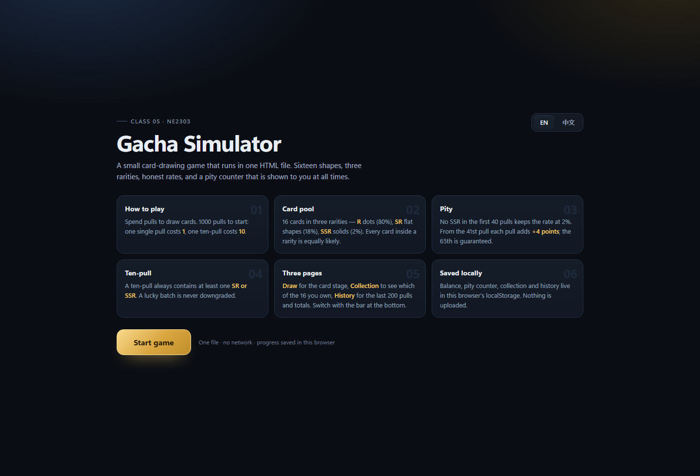
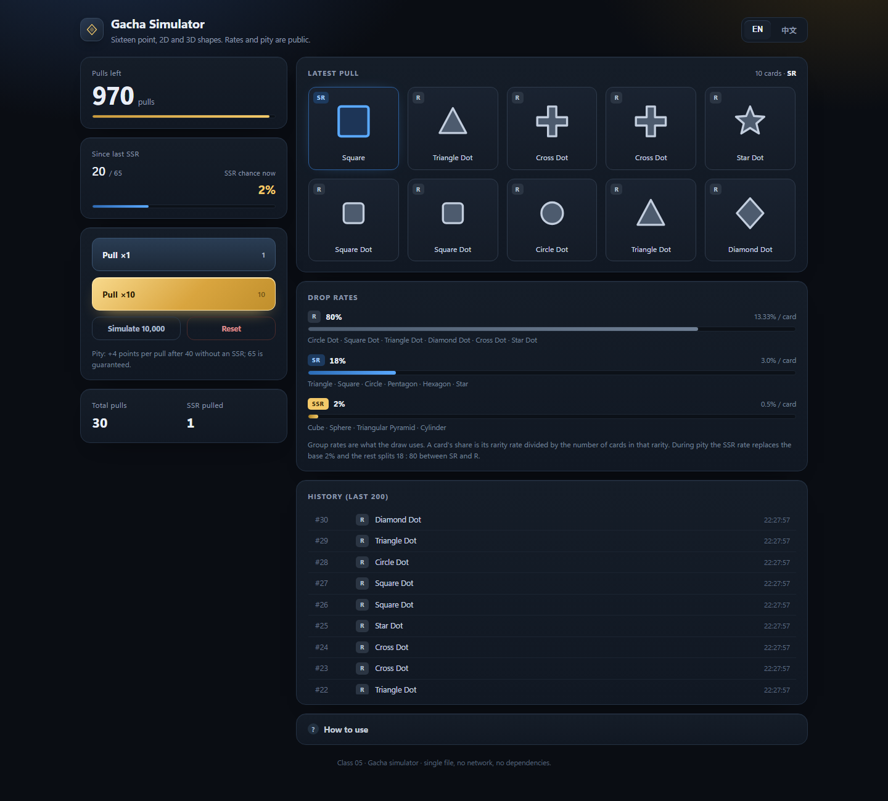
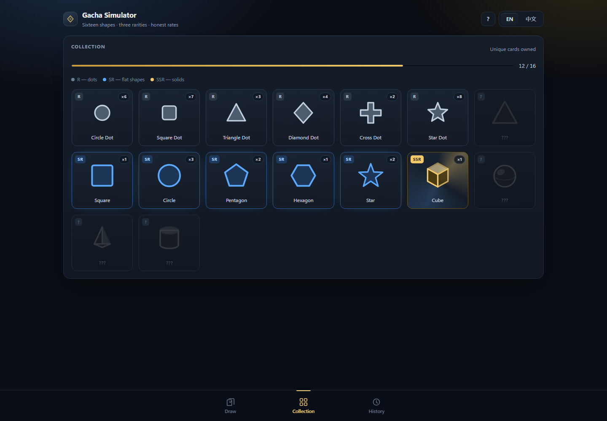

# Class 05 — Web Gacha Simulator

A small browser game: pull cards, each card a point, a flat shape or a solid.
Built as one self-contained HTML file with plain JavaScript — no framework, no
build step, no network calls.

It opens on a start screen with the rules, then runs as three pages — **Draw**,
**Collection** and **History** — switched from the bar at the bottom.

| Start screen | Draw | Collection |
| --- | --- | --- |
|  |  |  |

## Files

| File | What it is |
| --- | --- |
| [`SAM_CLASS_05_GACHA.html`](SAM_CLASS_05_GACHA.html) | The whole app: markup, CSS, JavaScript and SVG card art inlined. Double-click to play. |
| [`SAM_CLASS_05_USAGE.md`](SAM_CLASS_05_USAGE.md) | English user guide: screens, controls, rates, pity formula, saving, troubleshooting. |
| [`start.png`](start.png) | The start screen: title, language switch, six rule cards, start button. |
| [`screenshot.png`](screenshot.png) | The Draw page after three ten-pulls. |
| [`collection.png`](collection.png) | The Collection page, partly filled in. |

## Quick start

Double-click `SAM_CLASS_05_GACHA.html`, or serve the folder:

```bash
python -m http.server 8000
# http://localhost:8000/SAM_CLASS_05_GACHA.html
```

Then press **Start game**. The rules stay reachable later through the `?` button
in the header.

## Screens

| Screen | What lives there |
| --- | --- |
| Start | Bilingual rules: how to play, card pool, pity, ten-pull guarantee, the three pages, local saving. EN / 中文 switch top right. Button reads **Start game**, or **Continue** when there is saved progress. |
| Draw | Balance, pity counter and live SSR rate on the left; the ten cards from your latest pull on the right; the rate table and help below. |
| Collection | All 16 cards; owned ones show their name and how many you have (`×3`), unowned ones stay a grey silhouette with `???` until you draw them. A progress bar counts unique cards. |
| History | Totals (pulls, R, SR, SSR, actual SSR rate) plus the last 200 draws, newest first, colour-coded per rarity. |

## Spec in one table

| Item | Decision |
| --- | --- |
| Card pool | 16 cards: 6 dots (R), 6 flat shapes (SR), 4 solids (SSR) |
| Rarity rates | R 80%, SR 18%, SSR 2% (equal split inside each rarity) |
| Pity | 2% flat for pulls 1–40; +4 points per pull after that; guaranteed at 65 |
| Ten-pull | guarantees at least one SR or SSR; the forced slot rolls SSR at the current pity rate |
| Balance | 1000 pulls, single costs 1, ten-pull costs 10 |
| Pages | start screen → Draw / Collection / History, bottom tab bar |
| Saving | `localStorage`: balance, pity counter, totals, owned cards, last 200 history entries |
| Extras | live SSR rate display, 10,000-draw simulation, EN / 中文 switch, keyboard `1` `2` `3` for tabs, directional page transitions (respects `prefers-reduced-motion`) |

## Verification

Driving the real drawing code from a harness:

- 12 × 1,000 pulls → 31.8 SSRs on average (26–38), matching 2% base plus pity.
- 1,200 ten-pulls → every batch contained at least one SR or SSR.
- Longest observed gap between SSRs: 55 pulls, under the 65-pull ceiling.

The screens were checked by rendering the file in headless Chrome at 1440px and at
390px, in both languages, after zero, one and several ten-pulls. A scripted DOM test
in the same browser clicks through the whole flow — start screen, three ten-pulls,
tab switching, collection counts, history rows, save contents, language switch, back
to the rules — and asserts the visible numbers (20 checks, all passing). A second run
replays an older save to confirm the collection is rebuilt from history on upgrade.

## Notes

- Layout: controls on the left, card stage on the right; below ~620px the panel
  stacks on top, the tab bar stays pinned to the bottom, and the card grid drops to
  two columns.
- Cards carry their rarity in the frame, not only in a label: plain for R, a blue
  glow for SR, an animated gold shimmer for SSR.
- Single file on purpose: the requirement was "double-click and it runs", and that
  also means it works offline and can be handed in as one artifact.
- Card art is SVG (isometric for the solids) so the file stays small and needs no
  image assets or licenses.
- Progress is stored per browser and per machine; there is no backend.
