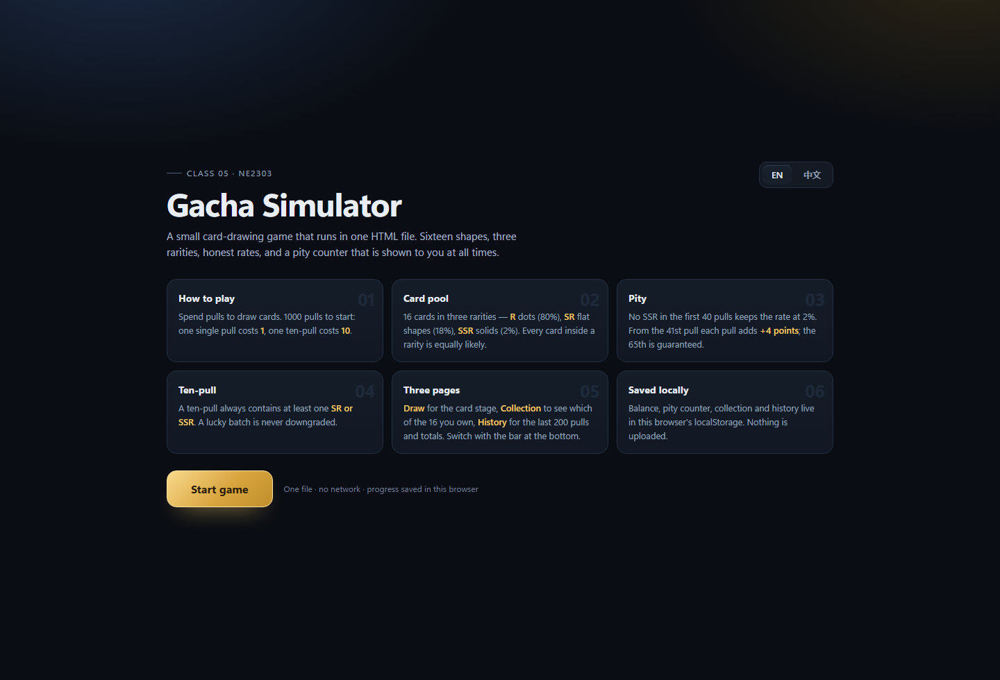

# Gacha Simulator — User Guide

A single-file browser mini-game: spend pulls to draw cards, where every card is a
dot (R), a flat shape (SR) or a solid (SSR). No install, no server, no network.

**File:** `SAM_CLASS_05_GACHA.html`



The game has a start screen and three pages — **Draw**, **Collection**, **History**
— switched with the bar at the bottom of the window.

---

## 1. How to open it

Double-click `SAM_CLASS_05_GACHA.html`. It opens in your default browser and runs
immediately.

If your browser asks what to do with the file, choose **Open with → Chrome / Edge**.
Everything is inlined in that one file (HTML, CSS, JavaScript, SVG art), so it also
works offline, from a USB stick, or after being emailed.

Optional: serve it over HTTP instead of `file://`:

```bash
cd class-05
python -m http.server 8000
# then open http://localhost:8000/SAM_CLASS_05_GACHA.html
```

Both ways give identical behaviour. There is no build step and no dependency.

---

## 2. Screens

### 2.1 Start screen

The file opens on the start screen: the title, an EN / 中文 switch, and six rule
cards — how to play, card pool, pity, ten-pull guarantee, the three pages, and where
the progress is saved. The rules are part of the page, so they can be read before a
single pull is spent.

The button at the bottom reads **Start game** on a fresh save and **Continue** once
there is progress. The `?` button in the header, once inside the game, brings this
screen back without touching any data.

### 2.2 Draw page

Controls on the left, the card stage on the right. On a narrow window the panel
stacks on top and the tab bar stays pinned to the bottom.

| Area | What it shows |
| --- | --- |
| Pulls left (top left) | the remaining balance as a big number, with a bar showing it against the 1000 start |
| Since last SSR | the pity counter, the live SSR chance, and a bar filling towards the 65-pull ceiling |
| Buttons | single pull, ten-pull, simulate 10,000 draws, reset everything |
| Total pulls / SSR pulled | running totals, saved with your progress |
| Latest pull | the cards from your most recent draw — R cards are plain, SR cards get a blue frame, SSR cards get a gold frame with a moving shimmer |
| Drop rates | one bar per rarity, with the group rate, the per-card share and the card names |
| How to use | a collapsible copy of the short instructions |

Before the first pull, the stage shows a row of empty card backs instead of a blank
box, so the page never looks broken or unfinished.

### 2.3 Collection page

All 16 cards on one grid, in pool order.

- A card you have never drawn stays a grey silhouette with `???` and a `?` corner tag.
- A card you own shows its art, its name, and a `×n` badge with how many copies you
  have drawn in total.
- The bar at the top counts **unique** cards: `11 / 16` means eleven kinds found.
- The legend above the grid explains the three rarity colours.

The collection fills in as you draw and is saved with the rest of your progress.

### 2.4 History page

| Area | What it shows |
| --- | --- |
| Summary cells | total pulls, R count, SR count, SSR count, and the **actual** SSR rate of your own draws |
| List | the last 200 draws, newest first: draw number, rarity chip, card name, time of day |

Rarity rows carry a coloured left border (blue for SR, gold for SSR), so a lucky
streak is visible at a glance.

### 2.5 Tab bar

The bottom bar switches between the three pages. On a keyboard, `1`, `2` and `3`
do the same thing.

Switching never just cuts: the page you enter fades in and rises a few pixels from
the side that matches the direction you moved (Draw → History comes in from the
right, History → Draw from the left), and the gold indicator on the tab bar pops
into place. Starting the game fades the rule screen out, then brings the Draw page
up the same way. Everything is CSS animation, roughly a third of a second, and it is
switched off automatically if your system asks for reduced motion.

---

## 3. Controls

| Button | Cost | Effect |
| --- | --- | --- |
| **Pull ×1** | 1 pull | Draws one card. |
| **Pull ×10** | 10 pulls | Draws ten cards; the batch is guaranteed to contain at least one SR or SSR. |
| **Simulate 10,000** | free | Runs 10,000 draws in memory and reports the measured distribution. Your balance, history and pity counter are untouched. |
| **Reset** | — | Asks for confirmation, then clears pulls, collection, history and the pity counter, and restores the 1000-pull balance. |

Buttons disable themselves when the balance is too low (fewer than 1 or 10 pulls).

Inside the game the `?` button in the header returns to the rules; the numbers `1`,
`2`, `3` switch pages.

---

## 4. Cards and drop rates

16 cards in three rarities, split evenly inside each rarity.

| Rarity | Cards | Group rate | Per-card share |
| --- | --- | --- | --- |
| **R** | Circle Dot, Square Dot, Triangle Dot, Diamond Dot, Cross Dot, Star Dot | 80% | 13.33% |
| **SR** | Triangle, Square, Circle, Pentagon, Hexagon, Star | 18% | 3.00% |
| **SSR** | Cube, Sphere, Triangular Pyramid, Cylinder | 2% | 0.50% |

Group rates sum to 100%. Inside a rarity every card is equally likely, so a
single SSR card is 0.5% and a single R card is 13.33%.

---

## 5. How the draw actually works

For each pull, in this order:

1. Compute the SSR probability from the pity counter (see below).
2. Roll it. If it hits, the card is an SSR and the counter resets to 0.
3. Otherwise split the remaining probability between SR and R in an 18 : 80 ratio,
   then pick a random card of that rarity.

At the base rate the numbers come out as 2% / 18% / 80%; during pity the SSR share
grows and the SR/R split takes the remainder.

**Ten-pull guarantee:** the 10th card is only forced when the first nine contain no
SR or SSR. That forced slot rolls SSR at the current pity rate and otherwise gives
SR, so a lucky ten-pull is never downgraded.

---

## 6. Pity rules

- Pulls 1–40 without an SSR: flat 2% each.
- From the 41st pull on: **+4 percentage points per pull**.
- The 65th consecutive pull without an SSR is guaranteed.

```
p(n) = 2%                       for n <= 40
p(n) = min(100%, 2% + 4% * (n - 40))   for n > 40
```

| Pull since last SSR | SSR chance |
| --- | --- |
| 1 – 40 | 2% |
| 41 | 6% |
| 45 | 22% |
| 50 | 42% |
| 55 | 62% |
| 60 | 82% |
| 65 | 100% (guaranteed) |

The counter resets the moment an SSR appears, whether it came from a single pull,
a ten-pull, or the guaranteed slot. The current value is always on screen, so the
displayed rate is the rate actually being used.

---

## 7. Saving

Progress lives in the browser's `localStorage` under the key `sam_gacha_v1`:

- remaining pulls and total pulls used
- the pity counter
- per-rarity totals
- which cards you own and how many copies of each (this is what the collection reads)
- the last 200 history entries

Refreshing or closing the tab keeps everything. The data is per browser and per
machine: another browser, another computer, or a private window starts fresh, and
nothing is uploaded anywhere. **Reset** clears all of it.

A save made by an older version of the file (before the collection existed) is
upgraded on load: the owned-card counts are rebuilt from the history that is still
in storage.

---

## 8. Language

The **EN / 中文** switch — on the start screen and again in the game header —
changes the whole interface: rule cards, buttons, card names, rate table, history and
help text. The choice is saved with your progress, so the start screen reopens in the
language you last used.

---

## 9. Verified behaviour

Checked with a simulation harness driving the real draw code:

- 12 runs of 1,000 pulls: **31.8 SSRs on average** (26–38 per run), consistent with
  a 2% base plus pity.
- 1,200 ten-pulls: **every batch contained at least one SR or SSR**.
- Longest gap between SSRs observed: **55 pulls**, below the 65-pull ceiling.

Use **Simulate 10,000** to reproduce a distribution check yourself.

---

## 10. Known limitations

- No backend, no accounts, no cross-device sync — by design.
- History is capped at 200 entries; older entries are dropped, the totals are kept.
- Only the standard browser APIs are used, so there is nothing to install, but the
  file must be opened in a modern browser (Chrome, Edge, Firefox, Safari).
- Cards are drawn as SVG, not images, which keeps the file small but means the
  art is geometric rather than illustrative.

---

## 11. Troubleshooting

| Symptom | Cause / fix |
| --- | --- |
| Pulls reset to 1000 after reopening | The browser blocks `localStorage` for `file://` (some hardened settings) or you are in a private window. Serve over `http://localhost` instead. |
| Buttons greyed out | Balance is under 1 or 10 pulls. Click **Reset** to start over. |
| Nothing happens on double-click | The file association is missing; right-click → **Open with** → your browser. |
| Page renders without styling | The file was opened as plain text (e.g. in an editor). Open it with a browser, not a text editor. |
