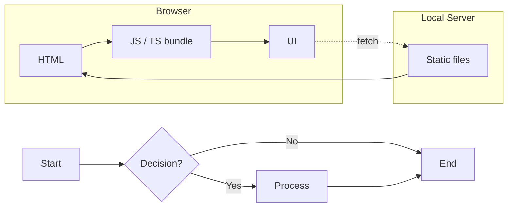
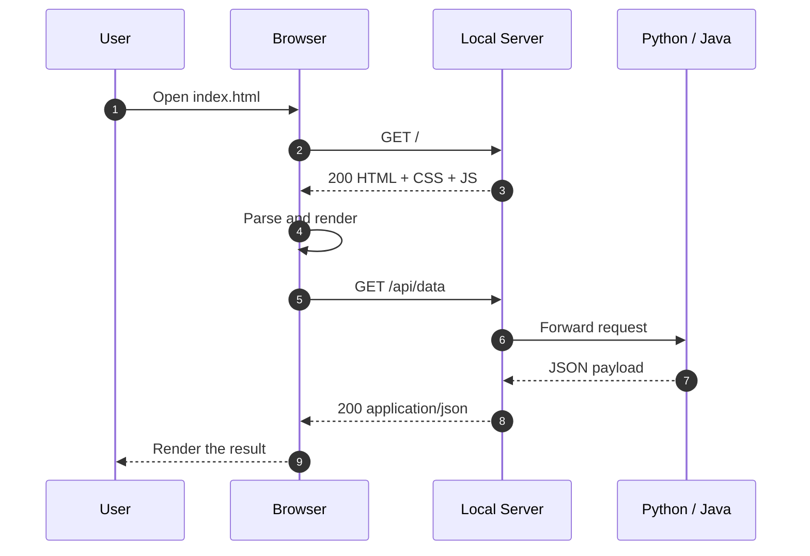

# Sam's Project

> Senior Capstone Project — a small playground for web tech — HTML, JS, TypeScript, Python and a bit of Java,
> all stitched together with Markdown and Mermaid diagrams.

---

## Overview

**Sam's Project** is a learning-by-building repository. It collects the pieces I keep
reaching for when I start something new on the web: a static HTML page, a bit of
vanilla JS, a TypeScript module, a small Python script and a thin web server that
serves the whole thing locally.

Nothing here is meant to be production-ready — the goal is to keep the feedback loop
short: edit, refresh, see the result.

## Maybe using HTML, or JS, web

The current shortlist of things this project touches:

- JS — DOM wiring, fetch, small utilities
- Python — scripting, data cleanup, quick prototypes
- TypeScript — typed modules that the browser can consume
- Java — the "what does this look like in a typed, compiled language?" reference
- Web Server — a local static server for development

## Tech Stack

| Layer      | Choice                    | Why                                      |
| ---------- | ------------------------- | ---------------------------------------- |
| Markup     | HTML5                     | Zero build step, works everywhere        |
| Styling    | Plain CSS                 | No framework overhead for a small demo   |
| Scripting  | JavaScript (ES2022)       | Runs directly in the browser             |
| Typing     | TypeScript                | Catch mistakes before runtime            |
| Backend    | Python / Java (reference) | Compare idioms side by side              |
| Dev server | `python -m http.server`   | One command, no dependencies             |
| Diagrams   | Mermaid                   | Diagrams as text, versionable in Git     |

## How It Fits Together



## Request Flow

The sequence below is the happy path for loading the page and fetching data:



## Getting Started

### Prerequisites

- [Node.js](https://nodejs.org/) 18+ (for `npm` and TypeScript)
- [Python](https://www.python.org/) 3.10+ (for the local server)
- [VS Code](https://code.visualstudio.com/) with the recommended extensions

### Run it locally

```bash
# 1. clone
git clone https://github.com/wbllbw3/Sam-project.git
cd Sam-project

# 2. install dev tooling
npm install

# 3. compile TypeScript (watch mode)
npx tsc --watch

# 4. serve the folder
python -m http.server 8000
```

Then open <http://localhost:8000> in a browser.

### Recommended VS Code extensions

- **Markdown Preview Mermaid Support** — renders the diagrams in the preview
- **Prettier** — consistent formatting on save
- **ESLint** — catches JS/TS mistakes early

These are already suggested in [`.vscode/extensions.json`](../.vscode/extensions.json),
so VS Code will offer to install them when the folder is opened.

## Usage

### JavaScript

```js
const el = document.querySelector("#app");

async function load() {
  const res = await fetch("/api/data");
  if (!res.ok) throw new Error(`HTTP ${res.status}`);
  const data = await res.json();
  el.textContent = JSON.stringify(data, null, 2);
}

load().catch((err) => console.error(err));
```

### TypeScript

```ts
type Task = {
  id: number;
  title: string;
  done: boolean;
};

const toggle = (task: Task): Task => ({ ...task, done: !task.done });
```

### Python

```python
print("Hello world")
```

### Java

```java
public class Main {
    public static void main(String[] args) {
        System.out.println("Hello world");
    }
}
```

## Project Structure

```text
Sam-project/
├── .vscode/
│   └── extensions.json    # recommended extensions
├── assets/
│   ├── style.css
│   └── logo.svg
├── src/
│   ├── main.js            # entry point
│   ├── utils.ts           # typed helpers
│   └── api.py             # small data endpoint
├── index.html
├── README.md
└── package.json
```

## Roadmap

- [x] Hello-world page in plain HTML
- [x] Mermaid flowchart for the decision logic
- [ ] Add a second page and shared navigation
- [ ] Move API calls behind a typed wrapper
- [ ] Add a simple test suite (`vitest`)
- [ ] Deploy a demo build to GitHub Pages

## Contributing

1. Fork the repo and create a branch: `git checkout -b feature/my-idea`
2. Make the change and keep the diff small
3. Open a pull request with a short description and a screenshot if the UI changed

## License

MIT — see [`LICENSE`](../LICENSE) for details.

---

<sub>Built with Markdown, Mermaid and VS Code. Diagrams live in this file, so they
never drift away from the code.</sub>
